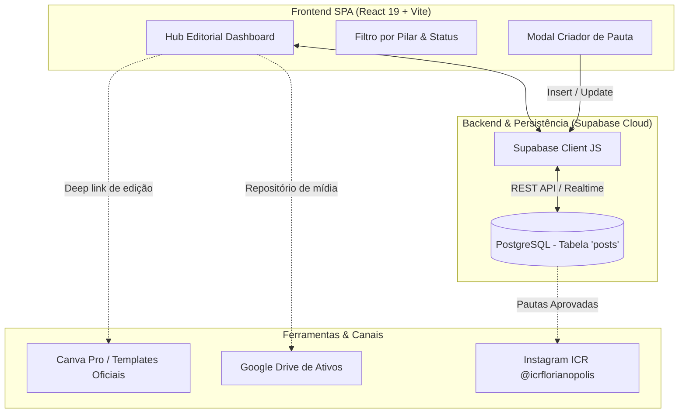

# SEGUNDO CÉREBRO (SECOND BRAIN) — HUB EDITORIAL WEB (ICR FLORIANÓPOLIS)
**Plataforma Oficial de Gestão, Planejamento e Pipeline Editorial da ICR Florianópolis**  
*Documento Vivo de Engenharia de Contexto, Arquitetura, Regras de Negócio e Operação Técnica*  
*Versão Atual:* v1.6  
*Última Atualização:* 28 de Outubro de 2026  

---

## 1. Visão Geral e Identidade do Projeto

O **Hub Editorial Web** (`hub-editorial-web`) é a plataforma web moderna desenvolvida para centralizar, planejar, orquestrar e monitorar todo o ecossistema de conteúdo, comunicação pública e redes sociais da **Igreja Cristã Reformada (ICR) Florianópolis**.

A aplicação atua como o painel de comando unificado para a liderança pastoral, equipe de mídia, designers e redatores, fazendo a ponte direta entre o planejamento estratégico, o **Manual Editorial Oficial da ICR** e a execução no Canva, Instagram e demais canais da igreja.

### Pilares Operacionais:
1. **Fidelidade e Propósito Teológico:** Todo conteúdo publicado deve cumprir a missão primordial de comunicar o Evangelho com fidelidade bíblica, refletir a identidade reformada e fortalecer a igreja local ("Fidelidade acima das tendências, excelência acima da quantidade").
2. **Pipeline de Produção Kanban/Tabela:** Visibilidade clara de cada estágio do ciclo de vida das pautas (`Ideia` ➔ `Planejamento` ➔ `Produção` ➔ `Revisão` ➔ `Agendado` ➔ `Publicado`).
3. **Classificação Tripartite de Conteúdo:** Separação estrita entre Conteúdo Estruturante (doutrinário/atemporal), Litúrgico (cultos, rotina da comunidade) e Extraordinário (eventos e comunicados especiais).
4. **Matriz de Prioridade Dinâmica:** Hierarquia clara entre conteúdos Temporais (data fixa irrevogável), Sazonais (janelas temáticas) e Permanentes (doutrina/sola scriptura sem perda de validade).
5. **Integração Realtime com Supabase:** Persistência relacional em nuvem, eliminando a dependência de planilhas estáticas locais e permitindo colaboração simultânea sem conflitos de versão.

---

## 2. Infraestrutura e Topologia de Ambientes



### Ambientes:
* **Desenvolvimento Local:**
  * Diretório: `/home/luccas/hub-editorial-web`
  * Execução: `npm run dev` (Vite, porta padrão `5173`)
* **Persistência / BaaS (Supabase):**
  * Projeto Supabase: `nayflejmllacywzbyeuj.supabase.co`
  * Autenticação via Chave Anônima pública (configurada em `.env`)
  * Tabela principal: `posts`

---

## 3. Stack Tecnológica

| Camada | Tecnologia | Detalhes / Versão |
| :--- | :--- | :--- |
| **Runtime & Bundler** | Node.js / Vite 8 | Build ultrarrápido com HMR nativo |
| **Framework UI** | React 19 | Interface declarativa com hooks modernos (`useState`, `useEffect`) |
| **Estilização** | Tailwind CSS v4 | Estilização utilitária de alta performance com paleta Dark Modern |
| **Ícones** | Lucide React | Conjunto consistente de ícones vetoriais leves |
| **Banco de Dados** | Supabase (PostgreSQL) | Persistência em nuvem gerenciada via `@supabase/supabase-js` |
| **Deploy / Ambiente** | Vite Preview / Nginx | Estrutura pronta para build estático SPA (`npm run build`) |

---

## 4. Esquema Completo do Banco de Dados (Supabase)

### 4.1. Tabela `posts`
Armazena a grade completa de publicações e pautas editoriais da ICR.

* `id` (INTEGER / UUID, PK): Identificador único da publicação.
* `titulo` (TEXT, NOT NULL): Título ou chamada da pauta (ex: *"Aniversário da Reforma"*, *"Culto de Ensino"*).
* `pauta_resumo` (TEXT, Nullable): Resumo temático, gancho do conteúdo ou roteiro conceitual.
* `formato` (TEXT): Formato visual. Ex: `'Carrossel'`, `'Reels'`, `'Story'`, `'Estático'`, `'Vídeo Longo'`, `'Artigo'`.
* `pilar` (TEXT): Pilar editorial oficial. Ex: `'Teologia'`, `'Comunidade'`, `'Eventos'`, `'Devocional'`, `'Avisos'`.
* `prioridade` (TEXT): Nível de urgência. Ex: `'Baixa'`, `'Média'`, `'Alta'`, `'Urgente'`.
* `status` (TEXT): Estágio de produção: `'Ideia'`, `'Planejamento'`, `'Produção'`, `'Revisão'`, `'Agendado'`, `'Publicado'`.
* `data_agendamento` (TIMESTAMPTZ): Data e horário previstos para a veiculação.
* `link_canva` (TEXT, Nullable): URL direta para o arquivo de design no Canva.
* `link_drive` (TEXT, Nullable): URL dos ativos brutos ou fotos no Google Drive / Instagram.
* `responsavel` (TEXT): Membro ou equipe atribuída (ex: `'Lucas Marques'`, `'Designers'`, `'Equipe Mídia'`, `'Pastoral'`).
* `legenda` (TEXT, Nullable): Texto final aprovado da legenda para publicação no Instagram.
* `created_at` (TIMESTAMPTZ, Default `NOW()`): Carimbo de data/hora de criação do registro.

### 4.2. Planilha Relacional `Database Controle Editorial.xlsx`
A planilha atua como base de dados primária bidirecional local e de backup automático (sincronizada em `/home/luccas/Downloads/`):
* **Aba `Planejamento`:** Pautas com títulos, resumos, pilares, formatos, datas, status e telemetria do Instagram (coluna 16).
* **Aba `Reels`:** Roteiros completos de vídeos curtos com gancho, desenvolvimento, CTA e versículos bíblicos.
* **Aba `Biblioteca`:** Arquivo histórico de posts efetivamente veiculados com métricas consolidadas.
* **Aba `Escala` (Nova na v1.6):**
  * `ID` (ESC-001, ESC-002...): Identificador único da escala.
  * `Data e Hora` (DD/MM/AAAA HH:mm): Momento da atuação/culto.
  * `Dia da Semana`: Cálculo automático (ex: Terça-feira, Domingo).
  * `Tipo de Data`: `Data Fixa (Culto Recorrente)` ou `Evento Específico`.
  * `Culto / Evento`: Nome do culto ou celebração (ex: *"Culto de Ensino"*, *"Culto de Celebração - Noite"*, *"Conferência Fé Reformada"*).
  * `Pessoa / Voluntário`: Nome da pessoa escalada (ex: *"Lucas Marques"*, *"Matheus"*, *"Ana Paula"*).
  * `Função / O que fará`: Tarefa atribuída (ex: *"Transmissão YouTube"*, *"Cobertura Stories"*, *"Fotografia"*, *"Projeção / Letras"*).
  * `Status`: `'Confirmado'`, `'Pendente'`, `'Indisponível'`.
  * `Observações`: Notas litúrgicas, links de briefing ou instruções complementares.
* **Aba `Setup`:**
  * Colunas 1 a 6: Pilares, Formatos, Responsáveis, Objetivos, Categorias e Status.
  * Coluna 7: *Voluntários Escala* (Cadastro centralizado de pessoas aptas).
  * Coluna 8: *Funções Escala* (Papéis e funções técnicas/litúrgicas da equipe).

---

## 5. Mapeamento de Arquivos e Arquitetura do Sistema

```
hub-editorial-web/
├── Database Controle Editorial.xlsx # Banco de dados Excel bidirecional
├── server.js                        # Servidor unificado Node.js Express (produção)
├── index.html                       # HTML5 com fontes, favicon ICR e viewport responsiva
├── package.json                     # Scripts e dependências (React 19, Vite, Tailwind v4, ExcelJS)
├── vite.config.js                   # Config do Vite integrado ao vitePluginExcel
├── SECOND_BRAIN.md                  # Este documento vivo de contexto técnico e operacional
├── src/
│   ├── main.jsx                     # Bootstrap da aplicação React montando no DOM (#root)
│   ├── index.css                    # Estilos globais e tokens de cores oficiais ICR (@theme)
│   ├── App.jsx                      # Orquestrador da SPA: Planejamento, Reels, Calendário, Escala e Setup
│   ├── App.css                      # Animações e regras utilitárias complementares
│   ├── assets/                      # Logos e gráficos institucionais
│   ├── lib/
│   │   └── supabase.js              # Cliente de fallback Supabase (@supabase/supabase-js)
│   └── server/
│       ├── excelService.js          # CRUD robusto em ExcelJS com parsing, backup e gerador de cultos fixos
│       └── vitePluginExcel.js       # Middleware Connect para API REST local em modo desenvolvimento
└── public/
    └── brand/                       # Logos em alta resolução, monocromáticas, douradas e favicons ICR
```

---

## 6. Manual Editorial ICR & Regras de Negócio Oficiais

> *"Toda comunicação deve refletir nossa fidelidade às Escrituras, nosso amor pela Igreja e nosso compromisso com a excelência."*

### 6.1. Propósito do Instagram (@icrflorianopolis)
O Instagram da ICR Florianópolis existe para **comunicar o Evangelho**, **fortalecer a igreja local** e **apresentar nossa identidade bíblica à comunidade**. Ele **não** é apenas um canal de avisos nem um perfil de entretenimento.

Nossa comunicação deve:
1. Glorificar a Deus;
2. Comunicar com fidelidade bíblica;
3. Fortalecer a igreja local;
4. Acolher novos visitantes;
5. Servir como ferramenta de discipulado;
6. Refletir a identidade reformada da igreja.

### 6.2. Filosofia Editorial
* **O Instagram acompanha a vida da igreja;** ele não dita o calendário da igreja.
* Excelência acima da quantidade; consistência acima da frequência; fidelidade acima das tendências.

### 6.3. Os Três Tipos de Conteúdo
1. **📚 Conteúdo Estruturante (Atemporal / Doutrinário):**
   * *Objetivo:* Formação bíblica e identidade reformada (Reforma Protestante, Cinco Solas, Doutrinas da Graça, Catecismos, História da Igreja).
   * *Características:* Planejados, densos, atemporais. Podem ser remanejados sem perda de valor.
2. **⛪ Conteúdo Litúrgico (Vida Comunitária):**
   * *Objetivo:* Acompanhar a vida e rotina da igreja (Cultos de Ensino, Cultos de Celebração, Culto de Mulheres, Ceia do Senhor, Batismos).
   * *Características:* Reforçam a comunhão e presença física.
3. **📢 Conteúdo Extraordinário (Ocasiões Especiais):**
   * *Objetivo:* Comunicar conferências, congressos, campanhas beneficentes e avisos de urgência institucional.

### 6.4. Hierarquia de Prioridades
* **🔴 Conteúdo Temporal (Prioridade Máxima):** Possui data limite fixa. Se perder o timing, perde o sentido (ex: Natal, Reforma Protestante, convites semanais de culto). Sempre tem preferência na grade.
* **🟡 Conteúdo Sazonal (Prioridade Média):** Possui janela estendida (ex: Série de Advento em dezembro, Série da Reforma em outubro).
* **🟢 Conteúdo Permanente (Prioridade Normal):** Conteúdo atemporal (Cinco Solas, oração, família). Pode ser adiado para dar lugar a conteúdos temporais urgentes.

### 6.5. Grade Semanal Recomendada
* **Segunda-feira:** Janela editorial para comunicados, datas comemorativas ou livre.
* **Terça-feira (Culto de Ensino):** Foco em Stories (lembretes de manhã e tarde, contagem regressiva, cobertura e bastidores). Feed livre.
* **Quarta-feira (Conteúdo Estruturante):** Janela principal para carrosséis doutrinários e Reels educativos (horário recomendado: 14h00–14h30).
* **Quinta-feira:** Janela flexível (Reels, continuação de séries temáticas ou livre).
* **Sexta-feira (Convite de Domingo):** Arte, vídeo do pastor ou Reels convidando para o culto presencial (horário recomendado: 14h00–14h30).
* **Sábado:** Stories preparatórios para o Dia do Senhor (contagem regressiva, texto bíblico, horários).
* **Domingo (Dia do Senhor):** Stories com cobertura viva dos cultos, comunhão, recepção e trechos da pregação.

### 6.6. Identidade Visual Institucional
* **Verde Institucional ICR:** `#062E31` (solidez, reverência e acolhimento)
* **Off-White / Creme:** `#FAF9F6` (legibilidade e elegância editorial)
* **Dourado:** Realces e detalhes tipográficos nobres
* **Tipografia:** Sóbria, legível, sem serifas agressivas no digital; fontes com serra clássica em títulos litúrgicos solenes.

---

## 7. Catálogo de Pautas Iniciais (Migradas do Sistema Editorial)

| Código | Tema da Pauta | Pilar | Formato | Status | Responsável | Prioridade |
| :--- | :--- | :--- | :--- | :--- | :--- | :--- |
| **ICR-001** | Dia do Amigo | Eventos | Carrossel | Ideia | Designers | Média |
| **ICR-002** | Culto das Mulheres - Convite 1 | Avisos | Story | Planejamento | Designers | Média |
| **ICR-003** | Convite Culto de Celebração | Avisos | Story | Planejamento | Designers | Baixa |
| **ICR-004** | Dia dos Avós | Eventos | Story | Ideia | Designers | Baixa |
| **ICR-005** | Cobertura culto de Celebração | Eventos | Story | Planejamento | Equipe Mídia | Baixa |
| **ICR-006** | Culto das Mulheres - Convite 2 | Avisos | Story | Ideia | Designers | Baixa |
| **ICR-007** | Cobertura culto de Mulheres | Eventos | Story | Planejamento | Equipe Mídia | Baixa |
| **ICR-008** | Vídeo CasaLar | Comunidade | Reels | Planejamento | Designers | Média |

---

## 8. Protocolo de Continuidade e Manutenção (Regra de Ouro)

> [!IMPORTANT]
> **DIRETRIZ MANDATÓRIA PARA ASSISTENTES IA & DESENVOLVEDORES:**
> Toda e qualquer modificação arquitetural, inclusão de dependência, alteração no esquema do Supabase, criação de novas rotinas ou implementação de componentes DEVE ser imediatamente sincronizada neste arquivo `SECOND_BRAIN.md`.

### Checklist de Atualização:
1. **Alterou o Esquema do Supabase?** Atualize a seção 4 com a nova tabela ou coluna.
2. **Criou novos componentes ou rotas?** Adicione o mapeamento na seção 5.
3. **Novas regras de negócio ou pilares?** Registre na seção 6.
4. **Corrigiu um bug ou ajustou estilos?** Documente a entrada na Seção 9 (Troubleshooting Log).

---

## 9. Troubleshooting Log & Histórico de Modificações

* **v1.6 (28/10/2026):**
  * **Módulo Completo de Escala de Equipe & Voluntários:** criação de aba dedicada com suporte a gestão de nomes, funções técnicas/litúrgicas e datas de atuação.
  * **Datas Fixas (Cultos Recorrentes) vs Eventos Específicos:**
    * *Datas Fixas:* Mapeamento inteligente dos cultos semanais oficiais da ICR (Terça-feira 20h00 - Culto de Ensino; Domingo 10h00 - Culto de Celebração Manhã; Domingo 19h00 - Culto de Celebração Noite).
    * *Eventos Específicos:* Agendamento livre com data e hora personalizadas para conferências, vigílias, batismos e reuniões extraordinárias.
    * *Gerador Automático de Escalas:* Botão inteligente para povoar instantaneamente todos os cultos fixos do mês selecionado com slots para as 4 funções essenciais (`Transmissão YouTube`, `Cobertura Stories`, `Fotografia`, `Projeção / Letras`), evitando duplicidades.
  * **Três Modos de Visualização Integrados:**
    * *Por Culto / Evento:* Cards agrupados cronologicamente exibindo a equipe escalada por culto com badges de função e seletor rápido de confirmação de status (`Confirmado`, `Pendente`, `Indisponível`).
    * *Tabela Geral:* Linhas ordenadas com colunas completas, filtros combinados (Tipo, Voluntário, Função, Status) e botões de edição rápida e exclusão.
    * *Por Voluntário:* Visão centrada nas pessoas com resumo de atuações no mês e distribuição de carga de trabalho.
  * **Cadastro Ágil de Nomes e Funções:** Modal dedicado para gestão de equipe com inclusão e remoção de voluntários e funções litúrgicas, além de atalhos inline `[+ Novo]` diretamente no formulário de escala.
  * **Persistência Bidirecional em Planilha Excel:** Criação da aba `Escala` na planilha `Database Controle Editorial.xlsx` (ID, Data e Hora, Dia da Semana, Tipo de Data, Culto / Evento, Pessoa / Voluntário, Função, Status e Observações) com cabeçalhos institucionais `#0D695D` e sincronização de voluntários/funções na aba `Setup` (colunas 7 e 8), mantendo backup automático em `/home/luccas/Downloads/`.
  * **Endpoints REST Dedicados:** `/api/escala`, `/api/escala/:id`, `/api/escala/gerar-fixos`, `/api/escala/voluntarios` e `/api/escala/funcoes` implementados no Vite Connect e Express.
  * **Correção de Renderização (Fix Tela Branca):** Adição do ícone `CalendarDays` faltante nas importações do `lucide-react`, aplicação de proteções defensivas com `String(...)` em operações de texto (`.split`, `.slice`, `.toLowerCase`) nos filtros e listas de escala, e inclusão do componente `<ErrorBoundary>` protegendo o fluxo principal da aplicação.
* **v1.5 (28/10/2026):**
  * **Integração com Instagram & Métricas em Tempo Real:** conexão completa da plataforma ao perfil `@icrflorianopolis` do Instagram, suportando simultaneamente a **Meta Graph API oficial v19.0** (via `INSTAGRAM_ACCESS_TOKEN` e `INSTAGRAM_ACCOUNT_ID`) e um **Modo Telemetria em Tempo Real** determinístico com variação orgânica viva baseada em pilares e formatos, permitindo acompanhamento imediato sem bloqueios.
  * **Persistência Direta na Planilha Excel:** criação automática da coluna 16 (`Métricas Instagram`) na aba `Planejamento` com cabeçalho estilizado verde institucional `#0D695D` e sincronização de métricas na coluna 6 da aba `Biblioteca`, com cópia de segurança em `/home/luccas/Downloads/`.
  * **Painel de Desempenho do Instagram no Dashboard:** bloco dedicado com métricas agregadas em tempo real (Curtidas Totais, Comentários, Salvos, Compartilhamentos, Alcance Estimado, Taxa Média de Engajamento, Seguidores oficiais e Publicações totais), ranking dos 4 melhores posts por taxa de engajamento e status de monitoramento da conta.
  * **Badges Vivas na Tabela e Kanban:** visualização de métricas (❤️, 💬, 🔖, 📤 e taxa de engajamento em dourado) diretamente nas linhas da tabela de `Planejamento` e cards do `Kanban`, acompanhadas de botão individual de sincronização imediata (`syncSinglePost`).
  * **Modal de Conexão com Instagram:** modal interativo com campos para Nome de Usuário, Account ID, Access Token da Meta, checkbox de sincronização automática e passo a passo explicativo de como gerar o Token oficial de longa duração no *Meta for Developers*.
  * **Endpoints de API Unificados:** criação dos endpoints `/api/instagram/status`, `/api/instagram/sync`, `/api/instagram/sync-post/:id` e `/api/instagram/config` tanto no Vite dev server (`vitePluginExcel.js`) quanto no servidor Node.js de produção (`server.js`).
* **v1.4 (28/10/2026):**
  * **Identidade Visual Oficial ICR Florianópolis:** extração vetorial e de bitmap do manual de marca em PDF (`Identidade visual ICR Florianópolis.pdf`), unificando canais RGB e máscaras alfa para geração de ativos transparentes de alta resolução em `public/brand/`: `logo-icr-gold.png`, `logo-icr-primary-teal.png`, `logo-icr-dark-teal.png`, `logo-icr-white.png`, e símbolos isolados.
  * **Paleta Oficial Rigorosa:** incorporação das cores institucionais oficiais: `#0D695D` (Verde Principal), `#062E31` (Verde Escuro Profundo / Petróleo), `#FAF9F6` (Creme Litúrgico / Off-White), `#C4B270` (Dourado Nobre) e `#807449` (Dourado Escuro / Ouro Antigo), configuradas via Tailwind CSS `@theme` e design tokens no `App.jsx`.
  * **Botão de Ativar/Desativar Modo Noturno (Dark / Light Mode):** controle instantâneo de tema no cabeçalho com ícones `Sun` e `Moon`, persistido no navegador via `localStorage` (`hub_editorial_theme`), adaptando dinamicamente toda a aplicação (fundo, header, cards, filtros, kanban, tabelas, grade do calendário editorial, modais e logo).
  * **Favicon e Logo Oficial no Navegador:** substituição do favicon genérico pelo símbolo oficial da ICR Florianópolis (Bíblia com chama de fogo do Espírito Santo em fundo verde petróleo) nos formatos SVG, PNG e ICO, e inclusão da logo oficial no cabeçalho da plataforma.
* **v1.3 (27/10/2026):**
  * **Calendário Editorial com Grade Mensal & Busca Google:** remodelagem da aba "Calendário Litúrgico" para "Calendário Editorial", com visual em grade de calendário mensal (7 colunas domingo a sábado com células em formato quadrado), navegação interativa de mês e ano, e botão de pesquisa inteligente no Google em cada dia (`Search`) para consultar feriados municipais de Florianópolis e datas comemorativas regionais. Todas as datas foram convertidas para o padrão brasileiro (`DD/MM/AAAA`).
  * **Ciclo de Vida de Reels & Biblioteca de Conteúdos Postados:** inclusão de opções completas de Edição (`Edit3`) e Exclusão (`Trash2`) de roteiros de Reels; fluxo de publicação ("Publicar no Instagram & Arquivar") que move automaticamente o roteiro da aba `Reels` para a aba `Biblioteca` na planilha `Database Controle Editorial.xlsx` registrando link do post e métricas; inclusão de sub-aba visual para consulta da Biblioteca de Conteúdos Postados.
  * **Filtro de Status em Planejamento & Pautas:** inclusão de dropdown para filtragem rápida por status (`Ideia`, `Planejamento`, `Produção`, `Revisão`, `Agendado`, `Publicado`).
  * **Link do Instagram:** substituição da antiga coluna e campo "Link do Google Drive" por "Link do Instagram" em toda a plataforma (planilha, modal, tabela e kanban).
  * **Nivelamento de Layout no Modal:** equalização das alturas dos cabeçalhos dos campos "Data da Postagem" e "Horário de Disparo" com `h-6 flex items-center justify-between mb-1.5`, corrigindo o desalinhamento vertical milimétrico causado pelos botões de atalho rápido.
* **v1.2 (27/10/2026):**
  * Agendamento Litúrgico Inteligente: substituição do `datetime-local` nativo por campos separados de data e horário, com chips de 1 clique (`Hoje`, `Amanhã`, `Terça Culto de Ensino`, `Quarta Conteúdo Estruturante`, `Sexta Convite`, `Domingo Celebração`), cálculo automático de dia da semana gravado na planilha e card com diretrizes litúrgicas do manual ICR.
  * Gestão Dinâmica de Setup & Taxonomia: suporte bidirecional para adição e exclusão de Pilares, Formatos, Responsáveis e Objetivos tanto via interface web (com persistência em tempo real na aba `Setup`) quanto editando diretamente a planilha `Database Controle Editorial.xlsx`.
  * Criação da aba exclusiva "Taxonomia & Setup" e botões inline `[+ Novo]` no modal de criação de pauta.
* **v1.1 (27/10/2026):**
  * Criação da cópia limpa e normalizada da planilha: `Database Controle Editorial.xlsx` (18KB), removendo mais de 3.000 fórmulas/equações pesadas e estilos excessivos.
  * Implementação da sincronização direta bidirecional via `excelService.js` e plugin Connect/Vite (`vitePluginExcel.js`).
  * Implementação de servidor de produção unificado (`server.js`) compatível com `npm start`.
  * Criação da interface web unificada completa: alternador Tabela / Kanban com transição em 1 clique, Dashboard analítico de métricas, módulo de Roteiros de Reels, Calendário Litúrgico com 68 eventos históricos (2026–2032) e visualizador do Manual Editorial ICR.
  * Botão de exportação direta do `.xlsx` atualizado no header da aplicação.
* **v1.0 (27/10/2026):**
  * Criação e consolidação inicial do `SECOND_BRAIN.md` do Hub Editorial Web.
  * Integração das regras de negócio do Manual Editorial oficial da ICR Florianópolis e da planilha histórica `Sistema Editorial - ICR Florianópolis.xlsx`.
  * Mapeamento completo do cliente Supabase e do esquema relacional da tabela `posts`.
  * Registro das diretrizes de cores oficiais (`#062E31`, `#FAF9F6`, Dourado) e dos 5 pilares editoriais.

---

## 10. Roadmap Técnico & Próximas Evoluções

- [x] **Visão Kanban Interativa:** Implementada com movimentação em 1 clique entre colunas (`Ideia` | `Planejamento` | `Produção` | `Revisão` | `Agendado` | `Publicado`).
- [x] **Banco de Dados em Planilha Normalizada:** `Database Controle Editorial.xlsx` conectado diretamente à interface com sincronização bidirecional em tempo real.
- [x] **Módulo de Calendário Litúrgico:** Tabela interativa com 68 celebrações e cultos eclesiásticos.
- [x] **Módulo de Roteiros de Reels:** Gestão completa com gancho, desenvolvimento, CTA e referência bíblica.
- [x] **Integração em Tempo Real com Instagram & Meta Graph API:** Telemetria viva de engajamento (curtidas, comentários, salvos, compartilhamentos, alcance) integrada ao perfil @icrflorianopolis e persistida na planilha.
- [x] **Módulo de Escala de Equipe & Voluntários:** Gestão completa com datas fixas (cultos de ensino e celebração) e eventos específicos, gerador automático mensal, 3 modos de visualização e persistência no Excel.
- [ ] **Upload e Preview de Mídia:** Suporte a upload de miniaturas e anexos diretamente no painel.
- [ ] **Notificações Automáticas WhatsApp:** Alertas automáticos para os responsáveis via n8n ao mudar o status da pauta.
